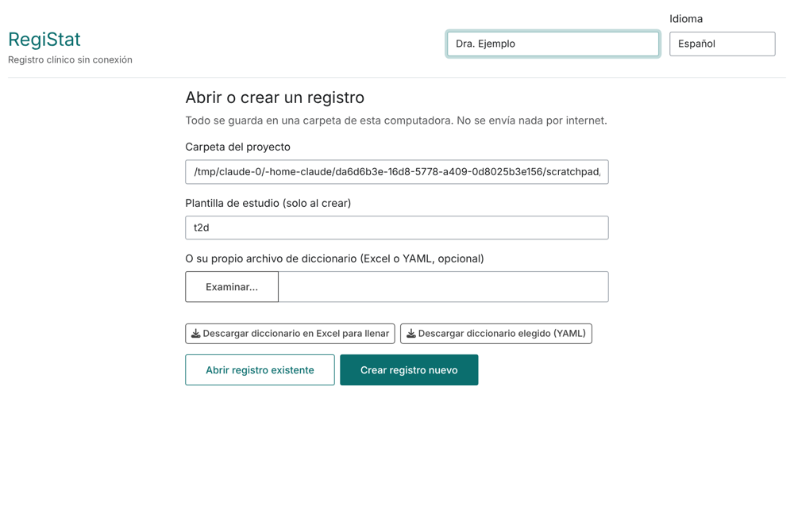
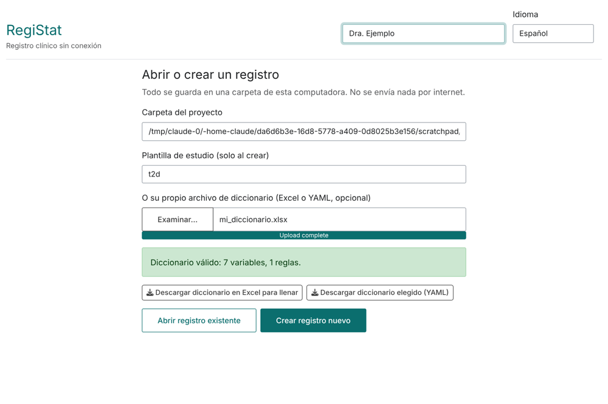
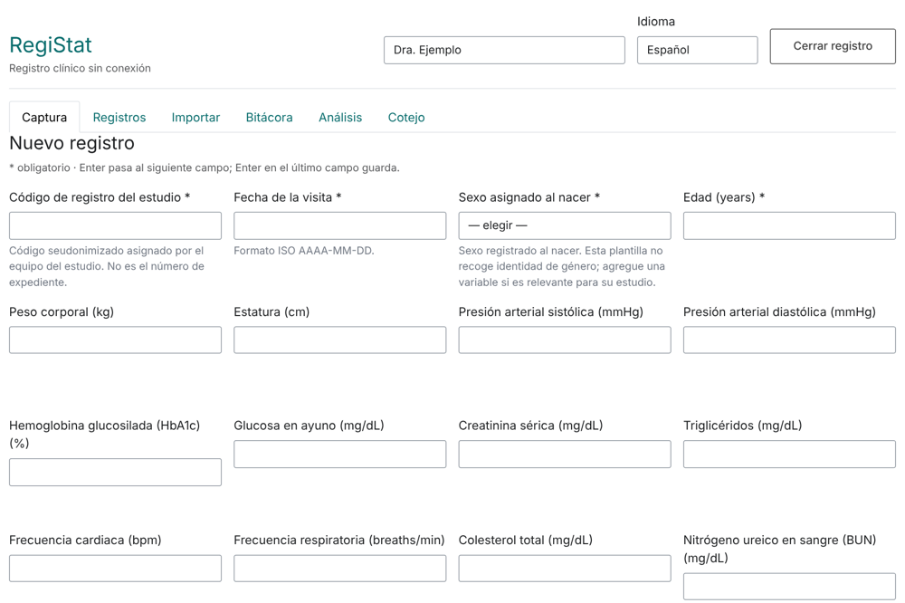
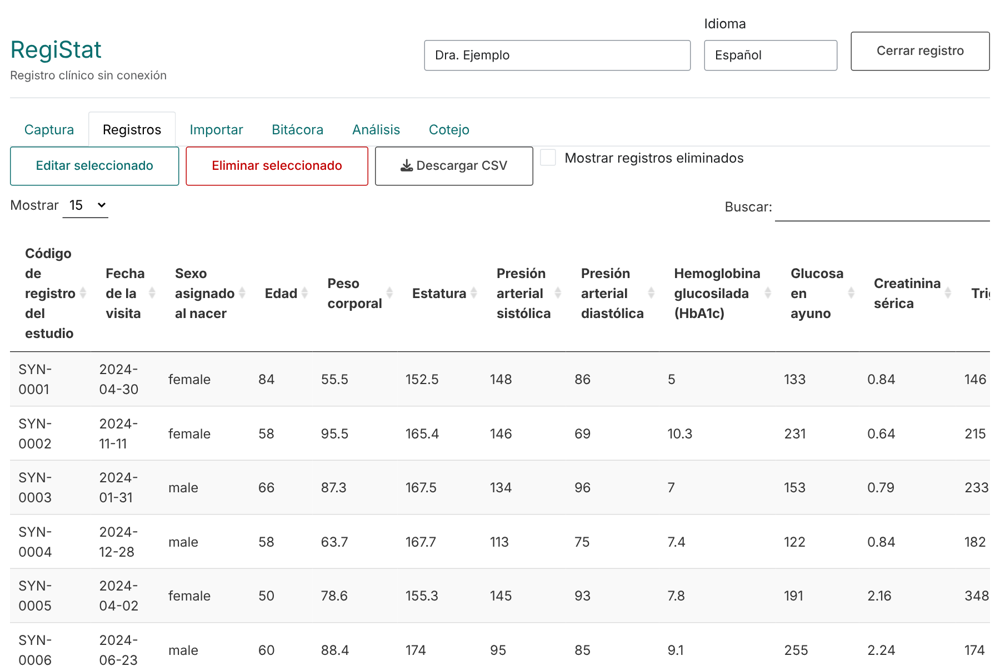
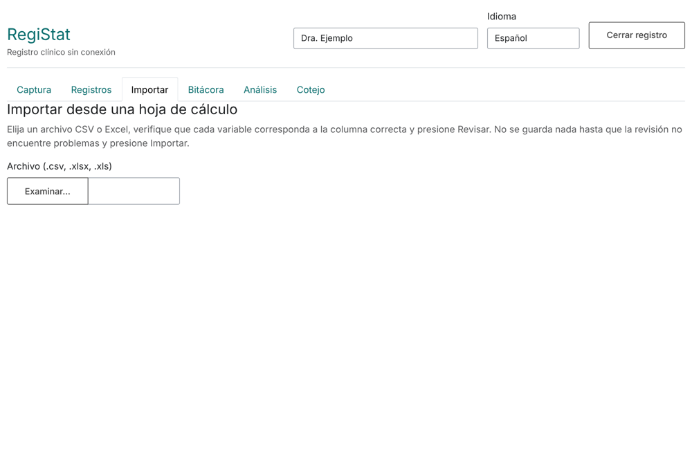
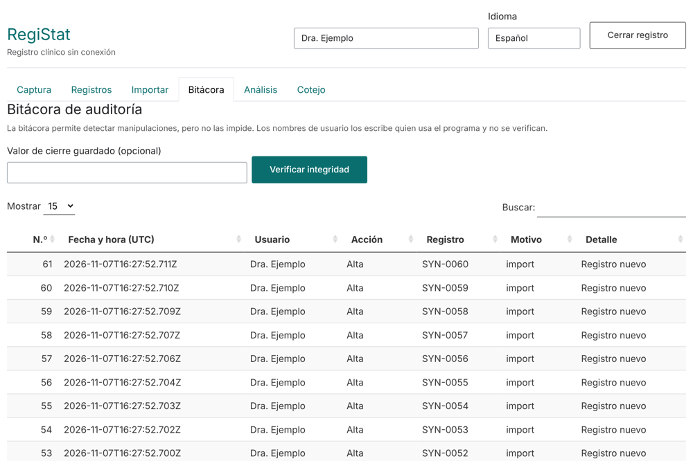
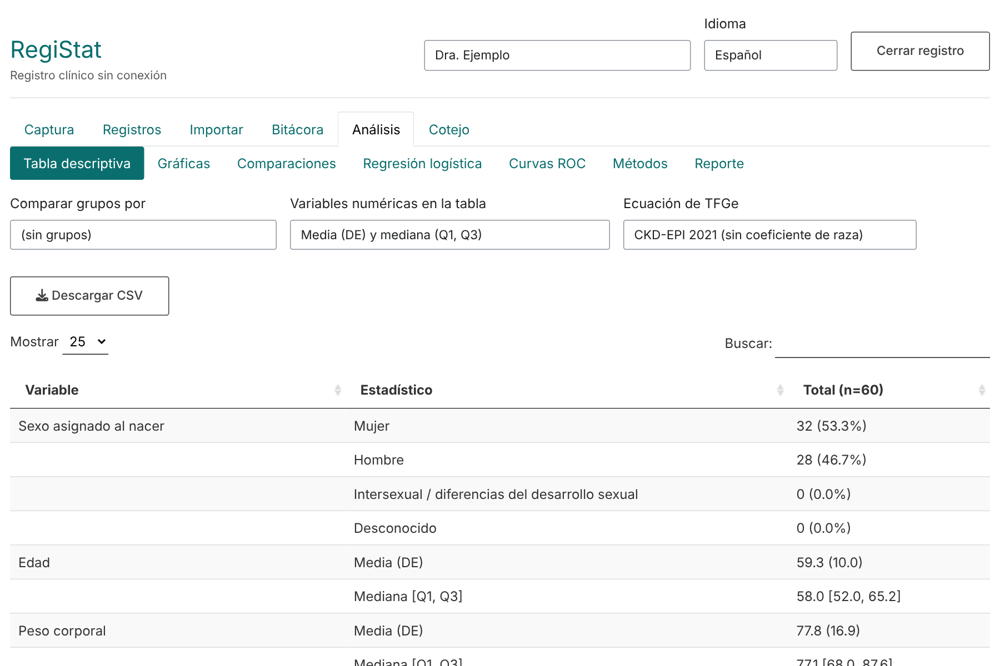
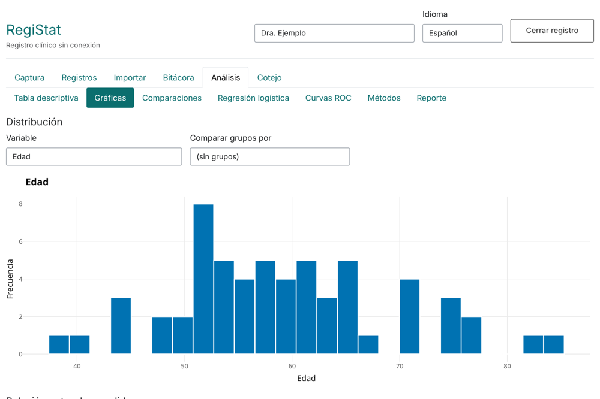
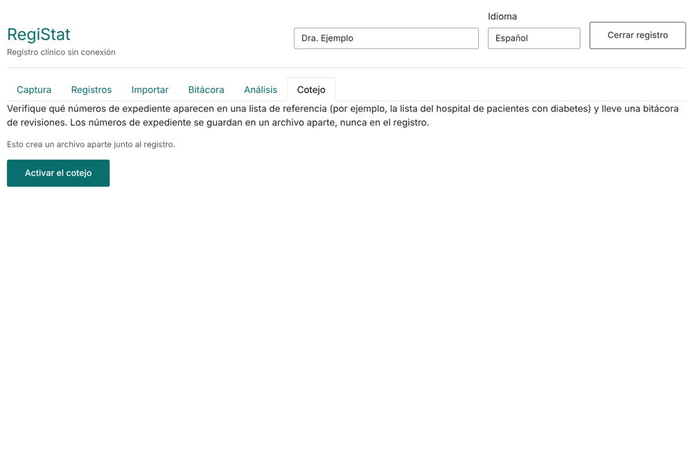

## 1. What it is and is not

RegiStat is a free, offline tool to capture clinical or laboratory registry data, store it with a hash-chained change log (it detects tampering, it does **not** prevent it), and analyse it reproducibly. Everything is stored in a folder on your computer; nothing is sent over the internet.

It is not a validated system for regulated clinical trials, it has no passwords or access control (the user name is typed by hand), and it does not replace ethics committee approval. Always use pseudonymised codes, never names or hospital file numbers.

## 2. Installation and start-up

1. Install R (https://cran.r-project.org/).
2. **Windows:** download `installer/Install-RegiStat.bat` and `Install-RegiStat.R` from the repository (same folder) and double-click the `.bat`. It installs RegiStat and creates `RegiStat.bat` on the Desktop.
   **Other systems** (or if you already use R): in R run

```r
install.packages("remotes")
remotes::install_github("fredie2370/RegiStat", dependencies = TRUE)
RegiStat::create_launcher()   # creates the start-up icon on the Desktop
```

3. To use it, double-click the icon (`RegiStat.bat`, `RegiStat.command` or `RegiStat.sh`). The browser opens. Close the black window to stop it. From R you can also run `RegiStat::run_app()`.

## 3. Start screen



Type your name at the top (it is recorded with every change). Choose the project folder and a template, or upload your own dictionary, and press **Create new registry**. To continue a study, choose the same folder and press **Open existing registry**.

## 4. Building your own data dictionary

The dictionary defines the variables, their types, ranges and rules; the capture form is generated from it.

1. On the start screen press **Download Excel dictionary to fill in**.
2. Fill in the sheets: `Study` (id, version and title in both languages), `Variables` (one row per variable), `Choices` (one row per option of each categorical variable) and `Rules` (optional cross-field checks). The `Instructions` sheet explains every column.
3. Upload the file under **your own dictionary file**. The app checks it and tells you it is valid or the exact problem (sheet and row).



Types: `id` (exactly one, a pseudonymised code), `integer`, `numeric`, `categorical`, `date`, `text`. Rules use only comparisons, arithmetic, `&`, `|`, `!` and `is.na()`, e.g. `diastolic_bp_mmhg < systolic_bp_mmhg`. You can also save the dictionary as YAML with **Download chosen dictionary**, or from R with `write_dictionary()`.

## 5. Data capture



The form warns about out-of-range values, required fields and broken rules before saving. Calculated measures (BMI, estimated GFR, TyG index, number of complications) are shown but never stored: they are always recomputed.

## 6. Records



Select a row to **edit** or **delete** it. Every change asks for a reason and is logged; deleted records are flagged, not erased. **Download CSV** exports the data.

## 7. Importing from a spreadsheet



Choose a CSV or Excel file, say which variable each column corresponds to, and press **Review**. Nothing is saved until the review finds no problems and you press **Import**.

## 8. Audit trail and integrity



Every creation, change or deletion is an entry chained by SHA-256 to the previous one. **Verify integrity** recomputes the chain and warns if anything was modified outside the application. It is evidence of alteration, not a security guarantee.

## 9. Analysis



The tabs include the descriptive table (optionally by group), missing data and outliers (3 x IQR rule), distributions, comparisons, correlations (Spearman with Holm), logistic regression (backward AIC selection, crude and adjusted OR), ROC curves and an AUC heat map.



Figures can be downloaded as PNG or SVG. `registry_report()` produces a self-contained HTML report with methods, results and the audit-trail hash, tying the report to an exact state of the registry.

## 10. Screening (case finding)



It lets you compare a list of file numbers against the registry without mixing identifiers into the data: it is kept in a separate file (`screening.sqlite`).

## 11. Backups and common problems

* Back up the project folder (`registry.sqlite`) regularly to another disk.
* **R not found** (Windows): install R and run the installer again.
* **The browser does not open**: open the address shown in the black window (http://127.0.0.1:...).
* **Dictionary error**: the message gives the sheet and row.
* **Report without Pandoc**: install `rmarkdown` and RStudio (includes Pandoc).
