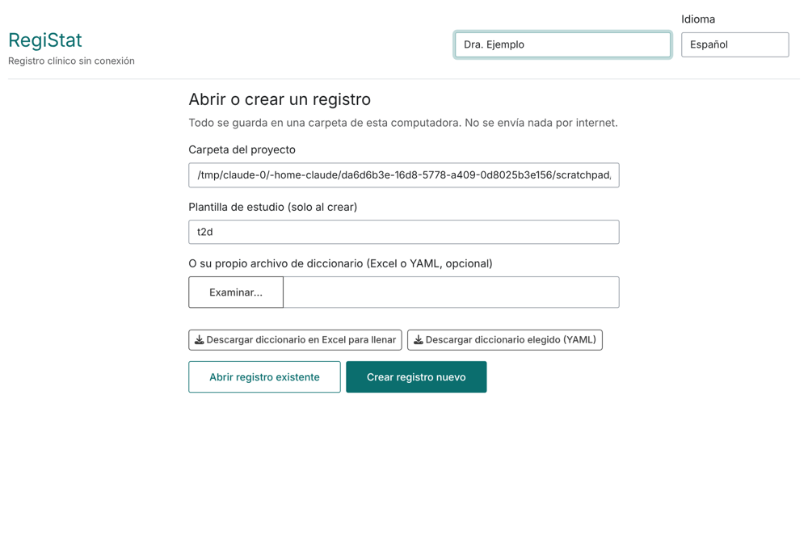
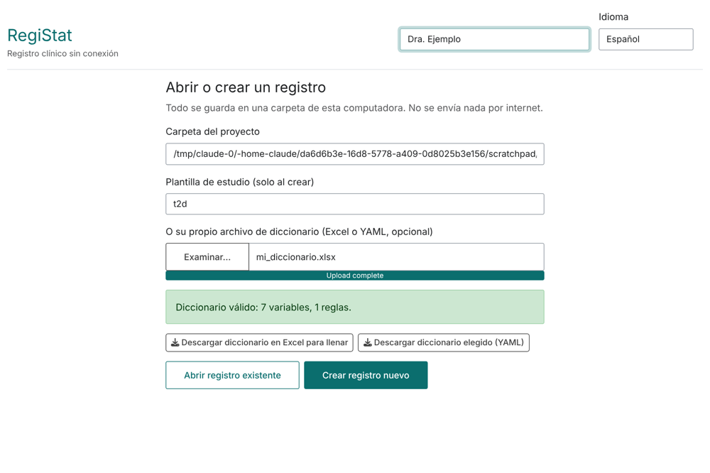
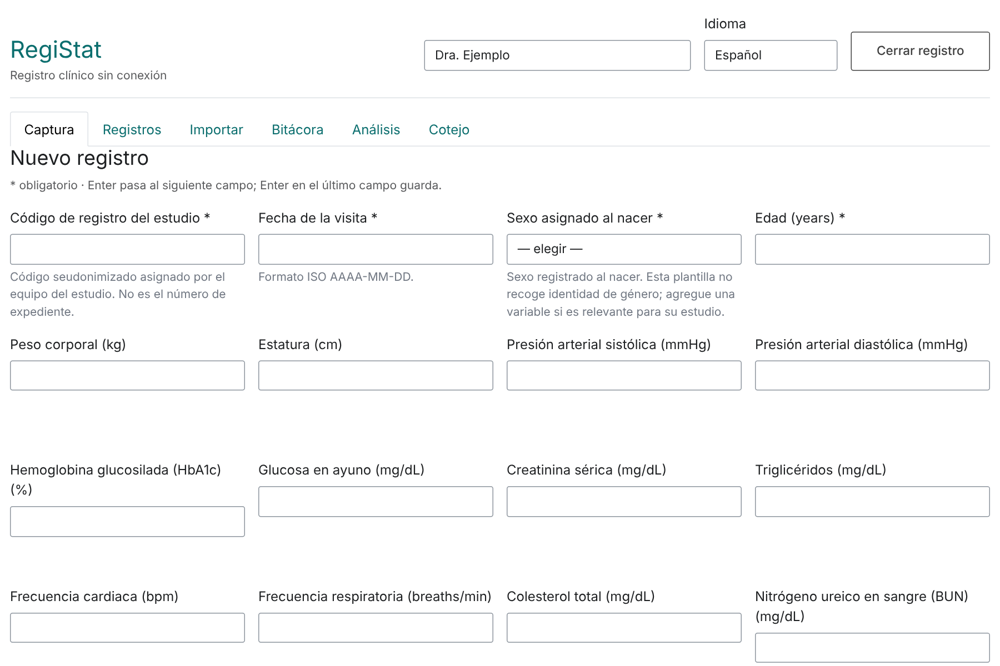
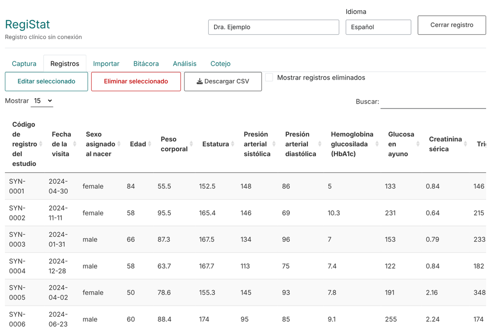
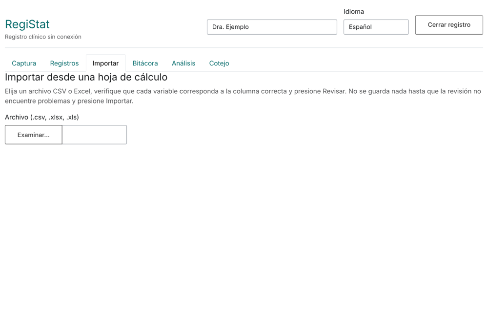
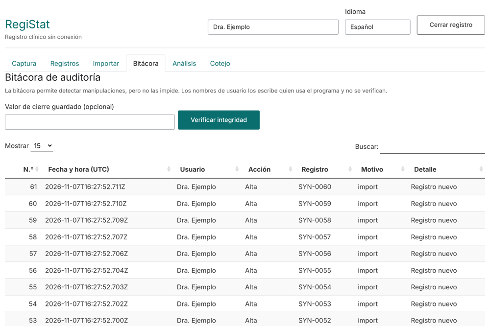
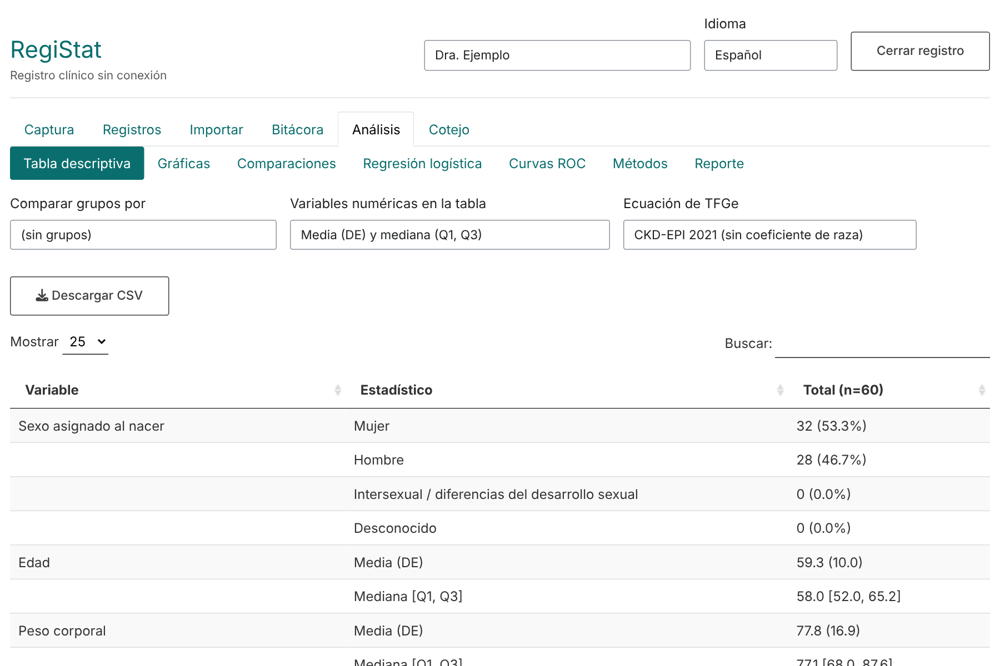
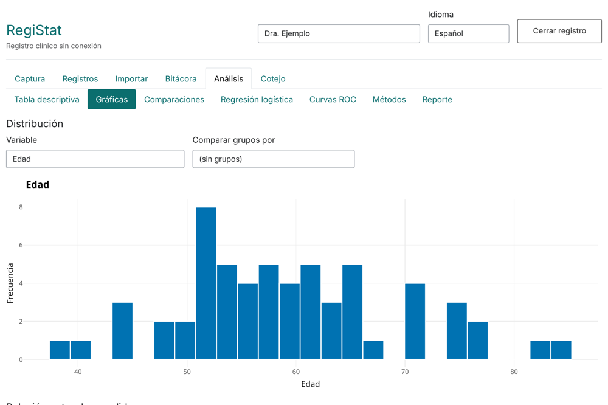
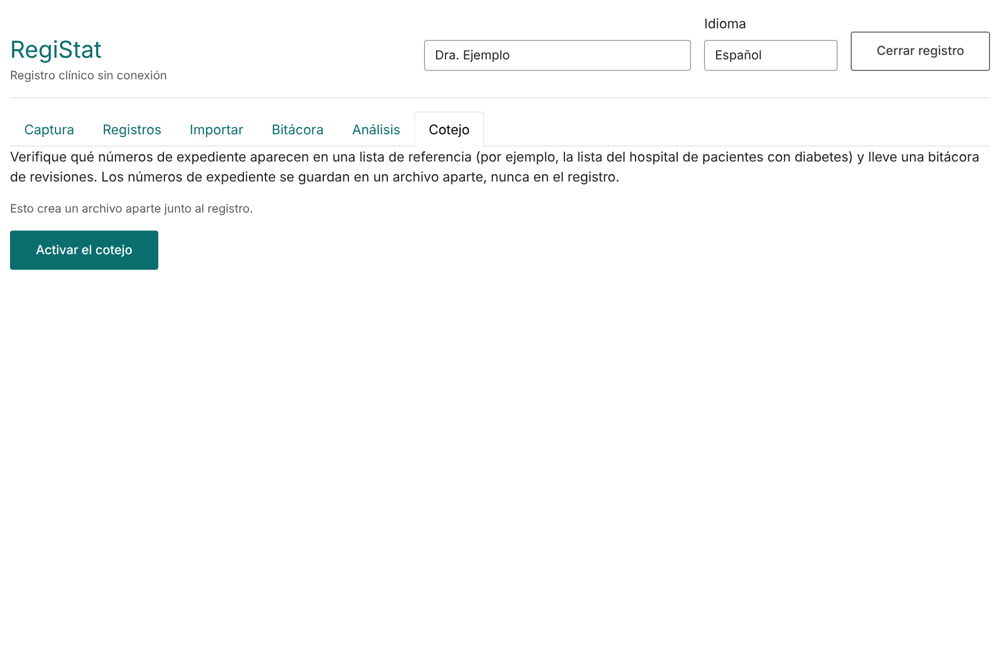

## 1. Qué es y qué no es

RegiStat es una herramienta gratuita y sin conexión para capturar datos de registros clínicos o de laboratorio, guardarlos con una bitácora de cambios encadenada con hashes (detecta alteraciones, **no** las impide), y analizarlos de forma reproducible. Todo se guarda en una carpeta de su computadora; no se envía nada por internet.

No es un sistema validado para ensayos clínicos regulados, no tiene contraseñas ni control de acceso (el nombre de usuario se escribe a mano) y no reemplaza la autorización de un comité de ética. Use siempre códigos seudonimizados, nunca nombres ni números de expediente.

## 2. Instalación e inicio

1. Instale R (https://cran.r-project.org/).
2. **Windows:** descargue `installer/Install-RegiStat.bat` y `Install-RegiStat.R` del repositorio (misma carpeta) y haga doble clic en el `.bat`. Instala RegiStat y crea `RegiStat.bat` en el Escritorio.
   **Otros sistemas** (o si ya usa R): en R ejecute

```r
install.packages("remotes")
remotes::install_github("fredie2370/RegiStat", dependencies = TRUE)
RegiStat::create_launcher()   # crea el icono de inicio en el Escritorio
```

3. Para usarlo, haga doble clic en el icono (`RegiStat.bat`, `RegiStat.command` o `RegiStat.sh`). Se abre el navegador. Cierre la ventana negra para detenerlo. Desde R también: `RegiStat::run_app()`.

## 3. Pantalla de inicio



Escriba su nombre en la parte superior (queda en la bitácora de cada cambio). Elija la carpeta del proyecto y una plantilla, o suba su propio diccionario, y presione **Crear registro nuevo**. Para continuar un estudio, elija la misma carpeta y presione **Abrir registro existente**.

## 4. Construir su propio diccionario de datos

El diccionario define las variables, sus tipos, rangos y reglas; el formulario de captura se genera a partir de él.

1. En la pantalla de inicio presione **Descargar diccionario en Excel para llenar**.
2. Complete las hojas: `Study` (id, versión y título en ambos idiomas), `Variables` (una fila por variable), `Choices` (una fila por opción de cada variable categórica) y `Rules` (revisiones opcionales entre campos). La hoja `Instructions` explica cada columna.
3. Suba el archivo en **su propio archivo de diccionario**. La aplicación lo revisa y le dice si es válido o el problema exacto (hoja y fila).



Tipos: `id` (exactamente uno, código seudonimizado), `integer`, `numeric`, `categorical`, `date`, `text`. Las reglas usan solo comparaciones, aritmética, `&`, `|`, `!` e `is.na()`, p. ej. `diastolic_bp_mmhg < systolic_bp_mmhg`. También puede guardar el diccionario como YAML con **Descargar diccionario elegido**, o desde R con `write_dictionary()`.

## 5. Captura



El formulario avisa de valores fuera de rango, campos obligatorios y reglas incumplidas antes de guardar. Las medidas calculadas (IMC, TFG estimada, índice TyG, número de complicaciones) se muestran pero nunca se escriben: se recalculan siempre.

## 6. Registros



Seleccione una fila para **editar** o **eliminar**. Cada cambio pide un motivo y queda en la bitácora; los eliminados no se borran, se marcan. **Descargar CSV** exporta los datos.

## 7. Importar desde una hoja de cálculo



Elija un CSV o Excel, indique a qué variable corresponde cada columna y presione **Revisar**. No se guarda nada hasta que la revisión no encuentre problemas y presione **Importar**.

## 8. Bitácora e integridad



Cada alta, cambio o baja es una entrada encadenada con SHA-256 a la anterior. **Verificar integridad** recalcula la cadena y avisa si algo fue modificado fuera de la aplicación. Es evidencia de alteración, no una garantía de seguridad.

## 9. Análisis



Las pestañas incluyen tabla descriptiva (opcionalmente por grupos), datos faltantes y valores atípicos (regla de 3× RIC), distribuciones, comparaciones, correlaciones (Spearman con Holm), regresión logística (selección hacia atrás por AIC, OR crudos y ajustados), curvas ROC y mapa de calor de AUC.



Las figuras se descargan en PNG o SVG. `registry_report()` genera un informe HTML autónomo con métodos, resultados y el hash de la bitácora, para atar el informe a un estado exacto del registro.

## 10. Cotejo (búsqueda de casos)



Permite contrastar una lista de expedientes con el registro sin mezclar identificadores con los datos: se guarda en un archivo aparte (`screening.sqlite`).

## 11. Copias de seguridad y problemas frecuentes

* Respalde la carpeta del proyecto (`registry.sqlite`) con regularidad en otro disco.
* **No encuentra R** (Windows): instale R y vuelva a ejecutar el instalador.
* **El navegador no abre**: abra manualmente la dirección que aparece en la ventana negra (http://127.0.0.1:...).
* **Error en el diccionario**: el mensaje indica hoja y fila.
* **Informe sin Pandoc**: instale `rmarkdown` y RStudio (incluye Pandoc).
